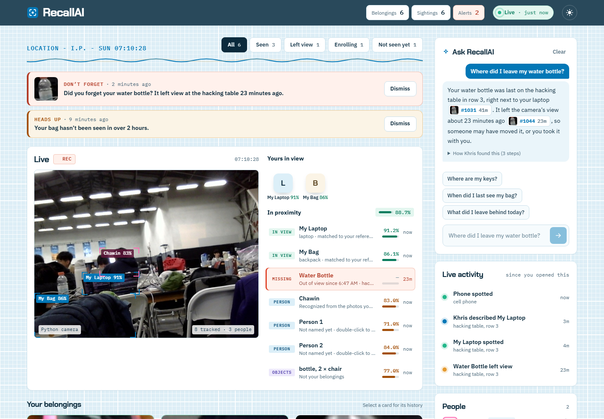
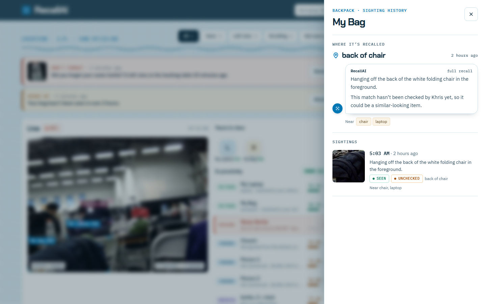
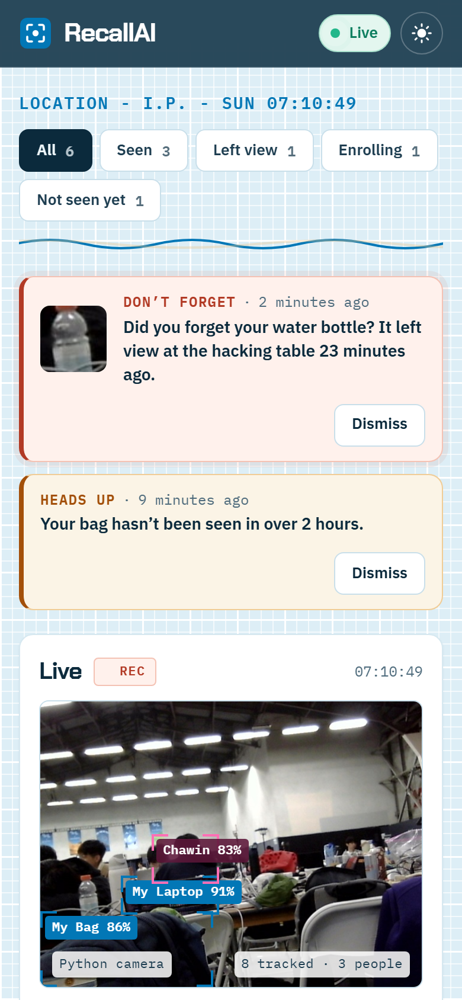
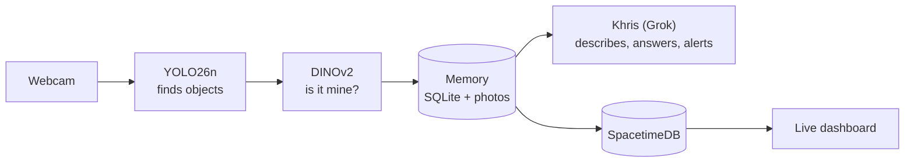

# RecallAI – CalHacks Object Finder

**"Where did I leave my keys?", answered by a camera that remembers.**

RecallAI watches a room through an ordinary webcam, recognizes *your* things
(not just "a bottle", but **your** bottle), and remembers where each one was
last seen, with a photo as proof. Ask in plain English and Khris, our
Grok-powered assistant, tells you where to look. If you seem to have left
something behind, it warns you.



<p align="center">
  
  &nbsp;
  
</p>

## What it does

- **Recognizes your items** from a few reference photos, so a stranger's laptop isn't mistaken for yours.
- **Remembers every sighting:** a photo, the time, what the item was next to, and your phone's GPS.
- **Keeps the last frame** an item was visible in. That's usually the moment you put it down.
- **Answers questions** like *"Where did I leave my water bottle?"*, with links to the snapshots it used.
- **Warns you** about items that left view and stayed gone, or that you walked away from.
- **Updates live** on laptop and phone, with a private account for each user.

## How it works



1. **Register:** show the camera an item from 3 angles.
2. **Detect:** YOLO26n finds objects in each frame ("a bottle, here").
3. **Recognize:** DINOv2 compares each object with your reference photos; a similarity of 0.70 or more means it's yours.
4. **Remember:** a `seen` snapshot at most every 15 s, and a `left_view` snapshot 5 s after the item disappears.
5. **Understand:** Khris (Grok) double-checks the match, describes where the item is, answers your questions and decides which alerts to send.
6. **Show:** a sync bridge copies everything to SpacetimeDB, which pushes it to every open dashboard instantly.

Without an xAI API key, everything except Khris still works. More detail: [docs/HOW_IT_WORKS.md](docs/HOW_IT_WORKS.md).

## Get started (Windows)

You need a webcam, [Python](https://www.python.org/downloads/) 3.10+ and
[Node.js](https://nodejs.org) 22. An [xAI API key](https://console.x.ai) is optional.

```powershell
git clone https://github.com/Slickstarlol/CalHacksObjectFinder.git
cd CalHacksObjectFinder
.\scripts\dev.ps1 setup
```

1. *(Optional)* Put `XAI_API_KEY=xai-...` in a `.env` file at the repo root (it's git-ignored).
2. Double-click **`launcher\RecallAI.bat`** and press **Start all**. This starts the server, the camera and the dashboard ([launcher guide](launcher/README.md)).
3. In the dashboard (http://localhost:5174), **create an account**. The first account takes over any data recorded before accounts existed.
4. Press **+** next to *Your belongings* and show your item to the camera from 3 angles.
5. Ask: *"Where did I leave my water bottle?"*

**On your phone:** open `http://<laptop-ip>:8000/` to share GPS, and `http://<laptop-ip>:5174` for the dashboard.
Phones only share GPS with `https://` pages, so for real GPS open the server through an HTTPS tunnel
(e.g. `cloudflared tunnel --url http://localhost:8000`).

## How we built it

Built at **CalHacks** (October 24–25, 2026) by Kentstar Harsono, jgsam, Chawin and Rihaan Merali.

- **Recognize by example, not by training.** Adding an item takes a few photos and no training step.
- **DINOv2 over CLIP.** We started with CLIP, but on our own frames DINOv2 separated "my bottle" from "a bottle" 3–4× better. We picked the 0.70 threshold from measurements: same item 0.77–0.95, other objects ≤ 0.64.
- **Remember moments, not video.** Two kinds of snapshot (`seen` and `left_view`) answer "where is it?" without recording everything.
- **Grok on top, not underneath.** Detection and memory run locally; Khris adds a second opinion, descriptions and answers, and cites the snapshots it used so you can check them.
- **SQLite for memory, SpacetimeDB for live updates.** SQLite is simple and testable; SpacetimeDB pushes changes to every browser.
- **Private and tested.** Every record belongs to one account. There are 250+ backend tests with Grok mocked, and CI runs on every push.

## Repository layout

```
backend/recallai/   Python app: vision/ (camera, YOLO, DINOv2), memory/ (SQLite, accounts),
                    ai/ (Khris: interpreter, agent, watcher), sync/ (SpacetimeDB bridge), api/ (FastAPI)
backend/tests/      pytest suite
frontend/live-dashboard/   React + TypeScript dashboard (:5174, or built into :8000/app/)
spacetimedb/        SpacetimeDB module (tables + reducers)
launcher/           one-click control panel (RecallAI.bat)
data/               belongings/ (reference photos); memory.db and snapshots/ (git-ignored)
docs/               how it works, architecture, accounts, data contract, team workflow
```

## More docs

[How it works](docs/HOW_IT_WORKS.md) ·
[Architecture](docs/ARCHITECTURE.md) ·
[Accounts and privacy](docs/AUTH.md) ·
[SpacetimeDB contract](docs/SPACETIME_CONTRACT.md) ·
[Team workflow and tests](docs/WORKFLOW.md) ·
[Launcher](launcher/README.md)

<details>
<summary><b>Running without the launcher, settings, and tests</b></summary>

Run each part in its own terminal (`scripts/dev.sh` takes the same commands on macOS/Linux):

```powershell
.\scripts\dev.ps1 server           # API, sign-in, search page, phone GPS page (:8000)
.\scripts\dev.ps1 camera           # webcam + recognition (--camera 1, --threshold 0.75)
.\scripts\dev.ps1 live-dashboard   # http://localhost:5174
.\scripts\dev.ps1 ask "where is my mouse?"
.\scripts\dev.ps1 register --list  # registered items (or add one: --name "My Keys" --category remote)
```

Settings (environment or `.env`):

| Setting | Default |
|---|---|
| `XAI_API_KEY` | none: Khris is off |
| `RECALL_VISION_MODEL` / `RECALL_AGENT_MODEL` | `grok-4.7` |
| `SPACETIME_URL` / `SPACETIME_DB` | `https://maincloud.spacetimedb.com` / `calhacks-l28u4` |
| `SPACETIME_SYNC=0` | turns the SpacetimeDB sync off |

Tuning: if someone else's item is labelled as yours, raise `--threshold`; if yours is missed, add more reference photos.

Tests: `.\scripts\dev.ps1 test` runs everything; `python -m pytest -m "not slow"` runs the fast backend tests.
</details>
