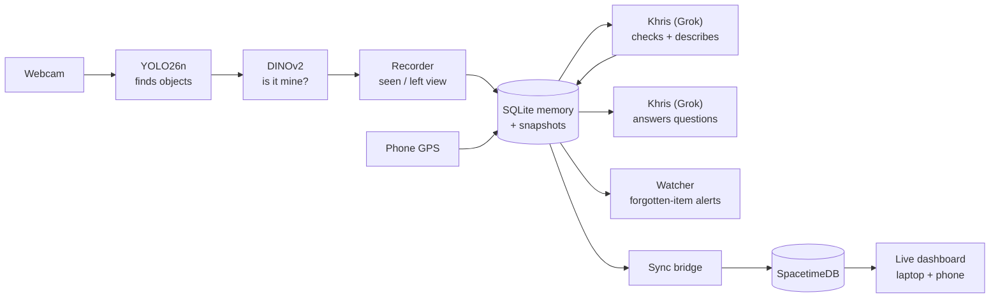
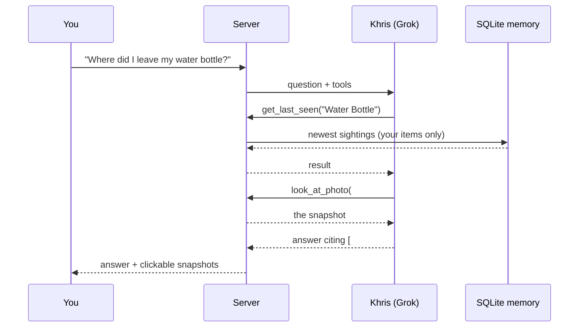

# How RecallAI works

RecallAI turns an ordinary webcam into a memory for your belongings. This page
follows one object, say your water bottle, from the moment the camera sees it
to the moment you ask *"Where did I leave my water bottle?"*.

No machine-learning background needed. Each section ends with the files that do
the work, if you want to read the code.

## The big picture



| Step | What happens | In one line |
|---|---|---|
| 1 | [Register](#1-teaching-it-your-things) | Show the camera your item from a few angles |
| 2 | [Detect](#2-finding-objects-in-each-frame) | YOLO finds every object in each video frame |
| 3 | [Recognize](#3-is-it-mine) | DINOv2 decides whether a detected object is *yours* |
| 4 | [Remember](#4-remembering-sightings) | Sightings are saved with a photo, the time, nearby objects and GPS |
| 5 | [Describe](#5-describing-the-scene) | Khris (Grok) double-checks the match and writes where it is |
| 6 | [Ask](#6-asking-questions) | Khris searches the memory and answers with photo evidence |
| 7 | [Alert](#7-alerts-for-forgotten-items) | A watcher warns you about items you may have left behind |
| 8 | [Show live](#8-the-live-dashboard) | SpacetimeDB pushes every change to the dashboard instantly |

**Khris** is RecallAI's assistant. It is powered by Grok, xAI's model, and does
steps 5, 6 and 7. Without an xAI API key, steps 1–4 and 8 still work and the
Grok features are skipped.

---

## 1. Teaching it your things

YOLO only knows general categories like "bottle" or "backpack". To tell *your*
bottle apart from everyone else's, RecallAI keeps a few reference photos of it.

Each belonging is a folder in `data/belongings/<id>/` holding:
- `info.json`: its name ("Water Bottle"), its category ("bottle") and which account owns it.
- Reference photos from different angles.

There are two ways to add one:
- **From the dashboard:** press **+** next to *Your belongings* and hold the item
  up to the camera. It saves a photo each time the item holds still for about
  0.75 s, and it needs **3 angles**. Turn the item between shots. The item is
  named after what YOLO sees ("cell phone"); rename it with the pencil button.
- **From the terminal:** `python -m recallai.vision.register` takes 5–8 photos
  that you capture with the keyboard (**S** saves, **B** lets you draw the box,
  **Q** finishes).

When the camera starts, it converts each reference photo into an *embedding*
(see step 3) and caches the result in the item's folder, so this happens only once.

> Code: `vision/enroll.py`, `vision/register.py`, `vision/recognition.py` (`load_belongings`)

## 2. Finding objects in each frame

The camera loop reads frames from the webcam and runs **YOLO26n**, a small, fast
object detector (`models/yolo26n.pt`). For each frame it returns boxes like
*"bottle, 82% sure, at these pixels"*. Detections below 35% confidence are ignored.

The same frame is also sent to the server about 8 times a second, with the
boxes drawn on it. That is the **Live** panel on the dashboard. If no frame
arrives for 2.5 s, the dashboard shows the camera as offline.

> Code: `vision/webcam.py` (camera loop), `vision/live_feed.py` (live frames)

## 3. "Is it mine?"

Twice a second, every detected box is cropped out of the frame and passed to
**DINOv2** (`facebook/dinov2-small`). DINOv2 turns an image into a list of
numbers, an *embedding*, so that two photos of the same object produce similar
numbers even when the angle or lighting changes.

The crop is compared with the reference photos of your belongings in the same
category. Categories that YOLO tends to confuse are checked too: a gaming mouse
up close sometimes comes out as "cell phone". For each belonging:

1. Measure how similar the crop is to each reference photo (cosine similarity, 0–1).
2. Average the **best 2** scores, so one odd reference photo can't cause a false match on its own.
3. If the best belonging scores **0.70 or more**, the object is **yours**.
   Otherwise it's *"a bottle, but not yours"*.

Why 0.70? We measured on this project's own camera frames:

| Comparison | Similarity |
|---|---|
| The same item in different frames | 0.77 – 0.95 |
| Other chairs in the same room | ≤ 0.64 |
| Strangers' objects (COCO photos) | ≤ 0.50 |

If someone else's item gets labelled as yours, raise the threshold
(`--threshold 0.75`). If yours is missed, add more reference photos.

**People** work the same way: photos of a person in `data/people/` are compared
with each detected person, with a slightly stricter threshold (0.75), so
the feed can say *"Chawin 83%"*.

> Code: `vision/recognition.py` (`BelongingMatcher`, `CONFUSABLE_GROUPS`), `vision/people_id.py`

## 4. Remembering: sightings

Saving every frame would fill the disk and teach you nothing. The **recorder**
saves only two kinds of moment, called *sightings*:

| Event | When it's saved | Why it's useful |
|---|---|---|
| `seen` | While the item is in view, **at most every 15 s** | A running record of where it is |
| `left_view` | When the item has been **out of view for 5 s**, using the **last frame it was visible in** | Usually the moment you put it down and walked away. This is the most useful memory of all. |

Each sighting stores:
- the full frame and a close-up crop (in `data/snapshots/`)
- the time
- the other objects next to it ("near a laptop and a chair")
- which account owns the item
- your phone's GPS location, if your phone shared one in the last 30 seconds

Everything goes into a SQLite database, `data/memory.db`, which is the single
source of truth.

An example of the water bottle's history:

```
14:02:10  seen       hacking table, row 3   (near laptop, cell phone)
14:02:25  seen       hacking table, row 3
14:19:48  left_view  hacking table, row 3   ← last frame it was visible in
```

> Code: `vision/recorder.py`, `memory/db.py`, `memory/temporal_memory.py` (time and duration math)

## 5. Describing the scene

A background thread sends each new sighting to Khris (Grok, model `grok-4.7`):
the snapshot with the item boxed in green, plus your reference photos. Images
are scaled down to 768 px to keep this fast and cheap. Khris records three
things:

- **verified**: is the boxed object really *your* item? This is a second opinion
  on top of DINOv2. Sightings Khris rejects are hidden.
- **description**: one sentence, e.g. *"Standing at the left edge of the table
  beside the laptop."*
- **place**: a short reusable label, e.g. *"hacking table, row 3"*.

The camera never waits for this; sightings appear immediately and gain their
description a moment later.

> Code: `ai/interpreter.py`, `ai/llm.py` (xAI client)

## 6. Asking questions

When you type *"Where did I leave my water bottle?"* in the dashboard (or the
search page, or the terminal), the server runs a **tool-using agent**. Khris
can't read the database directly. Instead it calls tools, looks at the
results, and calls more tools until it can answer (up to 8 rounds):

| Tool | What it returns |
|---|---|
| `list_belongings` | Your belongings and their most recent sighting |
| `search_sightings` | Sighting history, newest first, filtered by item, time, place… |
| `get_last_seen` | When and where an item was last seen, with the time since |
| `look_at_photo` | The snapshot of a sighting, so Khris can see it for itself |
| `get_context` | The current local time and your phone's live GPS |
| `list_people` | The people you saved: name, description, relationship |



The answer cites the sightings it used (`#1031`, `#1044`). The dashboard turns
these into thumbnails you can open, and **"How Khris found this"** lists each
tool call. The server decides whose data the tools can see; Khris can never
ask for another user's items.

> Code: `ai/agent.py`, `api/server.py` (`POST /api/ask`)

## 7. Alerts for forgotten items

Every minute, a **watcher** inside the server looks for two kinds of candidate:

- **Out of sight:** the item left the camera's view and hasn't been seen for
  **10 minutes**.
- **Moved away:** your phone is now more than **150 m** from where the item was
  last seen, meaning you probably walked off without it. This only uses a GPS
  fix from the last 2 minutes.

Khris then reviews the candidates, with their recent history, and decides which
deserve an alert. It writes a specific message, e.g. *"Did you forget your
water bottle? It left view at the hacking table 23 minutes ago."* Without an
API key, a plain template message is used instead. Each sighting can raise at
most one alert.

Alerts appear as a banner on the dashboard. On the phone GPS page they also
make the phone vibrate.

> Code: `ai/watcher.py`

## 8. The live dashboard

SQLite is the source of truth, but it can't push updates to a browser. So a
**sync bridge** (a thread inside the server) copies every change to
**SpacetimeDB** about every 1.5 s, by calling the module's reducers
(`upsert_belonging`, `upsert_sighting`, `upsert_alert`, `upsert_person`, …).
By default it uses the SpacetimeDB Maincloud database `calhacks-l28u4`.

The live dashboard subscribes to SpacetimeDB over a WebSocket, so a new
sighting appears on every open laptop and phone at once, with no refreshing.
Changes made in the dashboard travel the other way. For example, **Dismiss** on
an alert calls the `dismiss_alert` reducer, and the bridge copies that back
into SQLite.

> Code: `sync/spacetime_bridge.py`, `spacetimedb/src/index.ts` (tables and reducers),
> `frontend/live-dashboard/` (React + TypeScript). The data contract between them is in
> [SPACETIME_CONTRACT.md](SPACETIME_CONTRACT.md).

## 9. Accounts and privacy

- Everyone signs in with a username and password. Passwords are hashed with
  scrypt, and a sign-in lasts 30 days.
- Every belonging, sighting, alert and person belongs to **one** account. Every
  API endpoint filters by the signed-in user, and Khris reviews each user's items
  in a separate request, so one person's items never appear in another's prompt.
- The camera is a trusted device on the same computer as the server, not a
  user. It tags each sighting with the owner of the belonging it matched.
- The **first** account ever created takes over anything recorded before
  accounts existed.

> Details: [AUTH.md](AUTH.md)

## 10. Where the phone fits in

Open `http://<laptop-ip>:8000/` on your phone (same Wi-Fi) and sign in. The page
shares your location with the server for **your account only**. That location
is attached to new sightings of your items (step 4) and powers the *moved away*
alert (step 7). The live dashboard also works on a phone, so you can check on
your things from anywhere in the room.

---

## Map of the code

| Folder | Steps |
|---|---|
| `backend/recallai/vision/` | 1–4: camera loop, YOLO, DINOv2 recognition, recorder, enrollment, people |
| `backend/recallai/memory/` | 4, 9: SQLite schema, time math, accounts |
| `backend/recallai/ai/` | 5–7: Khris's interpreter, agent and watcher (Grok via the xAI API) |
| `backend/recallai/sync/` | 8: SQLite → SpacetimeDB bridge |
| `backend/recallai/api/` | FastAPI server: sign-in, search page, phone GPS page, API, live feed |
| `spacetimedb/` | 8: SpacetimeDB module (tables + reducers) |
| `frontend/live-dashboard/` | 8: the live dashboard (React + TypeScript) |
| `frontend/dashboard/` | Camera / enrollment / people dashboard (React) |
| `launcher/` | One-click control panel that starts everything |

For the system diagram with ports and endpoints, see [ARCHITECTURE.md](ARCHITECTURE.md).
